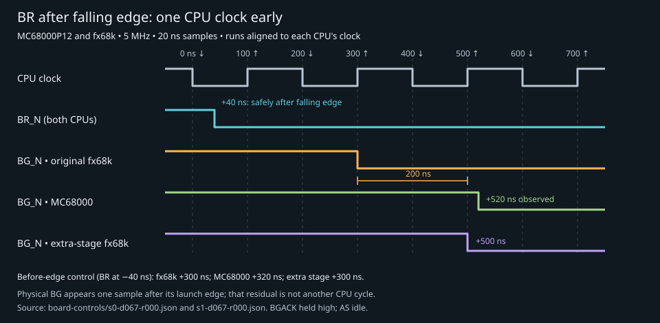

# Source-directed BR input-latching test

Build 14 adds an opt-in bus-request phase experiment. The upstream fx68k CPU
source is unchanged. No MCU or generic host-protocol changes are needed.

## Hypothesis

In `build/deps/fx68k/hdl/fx68k.sv:225`, the source comments identify the omitted
falling-edge BR/HALT registers as necessary for cycle accuracy for some input
phases. The active code samples `BRn` directly into `BRi` on `enPhi1`; the
commented alternative first samples `rBR` on `enPhi2`.

The experiment asserts BR after a falling CPU-clock edge but before the next
rising edge. Prediction: unmodified fx68k recognizes the request one CPU clock
earlier than the MC68000. As a control, assert BR before the falling edge.
A second control restores only the omitted BR sampling stage **outside** the
core, in the test wrapper. This is a diagnostic intervention, not a proposed
or qualified core fix. HALT is not tested here.

## Stimulus and safety

The program executes `MULU.W D1,D0` with D0=$1234 and D1=$ffff, then stores
the expected $1233edcc product and writes the normal completion marker.
The fetch of the NOP at $1000c triggers the scheduler. Its anchor is the first
rising clock edge after that fetch has completed through the synchronization
pipeline. Every lane gets its own anchor; absolute timestamps since reset are
not compared, because preceding bus cycles can take different times.

At 5 MHz, one CPU clock is 10 capture ticks (200 ns). BR is held low for 80
ticks by default. Delays 60–79 sweep two complete CPU-clock periods during the
multiply's internal execution. Each acquisition checks that AS remains high
through the entire BR/BG handshake, both signals deassert, the capture is
complete, and the product remains correct.

BGACK is always negated; the harness never takes bus ownership or drives the
address bus. The socket CPU clock continues while armed. Power-up uses the
existing 100 ms reset stabilization; the runner enforces exclusive 5 V and a
receipt-matched build, then powers all rails off in cleanup. DTACK scheduling,
data-buffer direction and continuous read drive are unchanged.

## Debug registers

All fields are little-endian 16-bit debug words. Configuration writes are
rejected while a run is active. Both diagnostic controls default off.

| Address | Field |
|---|---|
| $a0 | Enable BR experiment, 0/1 |
| $a2 | BR assertion delay from anchor, 0–255 ticks |
| $a4 | Low pulse width, 20–255 ticks |
| $a6 / $a8 | Trigger byte address, low 16 / high 8 bits; must be even |
| $aa | Model-only falling-edge input register, 0/1 |
| $ac / $ae | Read-only model anchor, low/high 16 bits |
| $b0 / $b2 | Read-only socket anchor, low/high 16 bits |

The public runner deliberately limits the phase/width range to the known
bus-idle multiply interval. Wider register ranges are not qualified stimuli.

**Special capture layout:** while $a0 is enabled, the usual 16 data bits are
replaced with BR_N in bit 0, BG_N in bit 1, and a constant 1 in bit 2 (the
negated BGACK command). Bit 2 is not a measurement of the socket BGACK pin.
Other pins retain their normal layout. Socket BR is FPGA-pad readback; clock
is the generated clock, not an oscilloscope measurement at the CPU package.
The model BR trace is before the optional diagnostic register. Do not run
the ordinary data-bus comparator on these captures. Scope ABI 4 is otherwise
unchanged; the per-run artifact explicitly identifies this overlay.

## Reproduction

Build the FPGA and direct/SPI simulators with the standard harness scripts.
The FPGA build must pass timing and pin gates. Then:

```sh
PYTHONPATH=host/src build/venv/bin/python -m validation.m68000.br_probe \
  --delays 63 67 --output build/validation/m68000/br-probe/new-sim.json

PYTHONPATH=host/src build/venv/bin/python -m nuboard.cli --json configure \
  build/fpga/m68000/outflow/m68000.hex.bin
PYTHONPATH=host/src build/venv/bin/python -m validation.m68000.br_probe \
  --target board --delays 63 67 --repeats 3 \
  --output build/validation/m68000/br-probe/new-board.json
```

Both original and extra-stage modes run by default. Use `--stages 0` for the
unmodified core alone. Omit `--delays` to sweep all 20 qualified phases.
Output paths must be fresh. Each case includes the raw change-compressed pin
capture, handshake timestamps, instruction/bus trace, product and SHA-256
reference from the parent report.

## Physical reproduction

The initial 12 paired trials all completed on the MC68000P12. Relative to the
falling clock edge near the request:

| BR assertion | Original fx68k BG low | MC68000 BG low | Extra-stage fx68k BG low |
|---|---:|---:|---:|
| −40 ns (before edge) | +300 ns | +320 ns | +300 ns |
| +40 ns (after edge) | +300 ns | +520 ns | +500 ns |

The after-edge request changes **which rising edge** launches BG, not merely
its propagation delay. Physical BG is first observed one 20 ns capture tick
after its launch edge; that is not a precise 20 ns propagation measurement.
The diagnostic stage removes the full-cycle difference. The product remains
correct because no bus ownership transfer is performed.



The subsequent full sweep completed **200 paired trials** (20 phases × two
stage settings × five repeats). All five repetitions agree at every phase.
Original fx68k grants one clock early for delays 65–69 and 75–79; delays
60–64 and 70–74 agree in launch cycle. The extra-stage model agrees in launch
cycle at all 20 phases. Every physical grant has a one-tick residual relative
to its launch edge. Edge-coincident stimuli are included in the sweep but
the ±40 ns controls establish the result away from the edge.

All 400 CPU executions in that sweep completed, retained the expected product,
and kept AS inactive through arbitration. The direct simulation's grant offsets
match the FPGA model at all 40 phase/stage settings. All rails were confirmed
off afterward by cleanup and a separate USB status read.

Evidence: `build/validation/m68000/br-probe/board-controls.json` and its
per-case directory; `s0-d067-r000.json` is the small original-core reproducer.
The full sweep is `build/validation/m68000/br-probe/board-phases.json`.
The 40-case direct simulation and four-case SPI simulation cover the same
phase controls. The existing 64 simulator tests passed, as did two new focused
BR tests. These results do not qualify arbitrary arbitration sequences, HALT,
or all fx68k inputs. The earlier probe-disabled native timing failure remains
recorded in `docs/m68000-read-probe.md`; it has not been waived.
