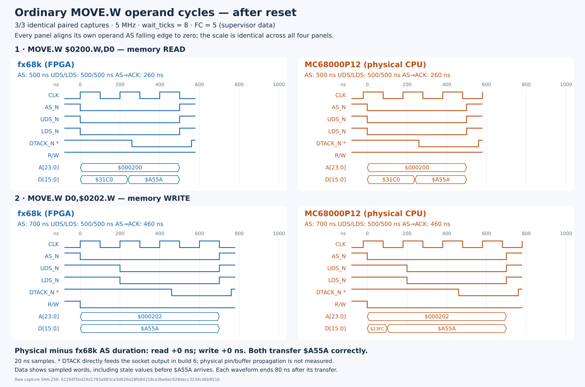

# Immediate data direction: build 5 hardware result

Build 6 additionally removes the strobe/data-ready drive cutoff; see
[continuous read drive](#build-6-continuous-read-drive) below. The build 5
measurements and evidence are retained unchanged.

Removing the clocked buffer turnaround and socket-only read-ACK gate eliminates
the measured execution-time mismatch in the sequential-read experiment. The
physical MC68000P12 now matches the on-board fx68k at 5 MHz, with wait_ticks=8.
Three planned repetitions gave identical measurements and correct results.

## Change

In `fpga/m68000/nuboard_m68000.v`, the same combinational `want_drive` signal
now controls T0/T1 DIR and all sixteen FPGA data-output enables. No direction
register or turnaround counter remains. Both external bank OEs stay enabled
while the socket is armed; disarming disables them and releases FPGA drive.
The raw AS, R/W, and UDS/LDS conditions still cut off read drive immediately,
including between the read and write portions of TAS.

Socket DTACK now receives the memory responder's acknowledgement directly,
without the former read-only buffer-ready gate. The existing shared responder
still makes read data ready one 20 ns clock before asserting DTACK. The change
removes the socket adapter's extra 100 ns drive delay / 80 ns ACK delay, not
the common responder's memory latency.

The only changed synthesis inputs versus build 4 are this pin adapter and the
mailbox's build identity (4 to 5). The MCU, generic host software, fx68k source,
memory responders, clock settings, scope RTL, pin assignments, and timing
constraints are unchanged. Timing test drivers accept the new build identity.

## Before and after

| Measurement | fx68k, both builds | MC68000 build 4 | MC68000 build 5 |
| --- | --- | --- | --- |
| Zero-read marker window | 3.4 us | 4.0 us | 3.4 us |
| Eight-read marker window | 16.2 us | 20.0 us | 16.2 us |
| Baseline-subtracted eight-read cost | 12.8 us / 64 clocks | 16.0 us / 80 clocks | 12.8 us / 64 clocks |
| Successive operand-read start interval | 1.6 us | 2.0 us | 1.6 us |
| Operand read AS/UDS/LDS asserted | 500 ns | 700 ns | 500 ns |
| Operand write AS asserted | 700 ns | 700 ns | 700 ns |
| Operand write UDS/LDS asserted | 500 ns | 500 ns | 500 ns |
| Read data first sampled after AS | 240 ns | 340 ns | 240 ns |

The eight-read program still verifies all eight saved register words,
`$A550..$A557`. All six baseline/eight-read runs compare complete traces:
213 transfers per CPU, with functional and relative timing equality.
See [the original experiment](m68000-read-sequence.md) for the program and
marker-based subtraction method.

The ordinary read/write experiment also passes three repetitions, comparing
all 18 transfers each time and verifying both RAM words equal `$A55A`.
Read AS-to-ACK is 260 ns on both lanes; write AS-to-ACK is 460 ns on both.
The remaining physical write-data arrival offset is unchanged: 100 ns after
AS versus already present at AS for fx68k, before UDS/LDS assert at 200 ns.

Each waveform aligns its own AS falling edge. The socket's initial run offset
remains 220 ns; trace timing comparison aligns the first transaction and does
not claim identical reset-exit latency. Captures are 20 ns FPGA observations,
not analog measurements at the CPU package. In build 5 the captured DTACK net
also directly drives the socket output, but pin/buffer propagation and electrical
contention margins are not measured or electrically qualified here.

## Regression and build checks

- New `bash fpga/m68000/test_pins.sh` regression passes with the clock held
  stopped: immediate read drive/DIR, both byte selects, raw AS/R/W/strobe
  cutoff, direct ACK, and disarming.
- Existing lane reset-qualification test, 13 harness/timing tests, and 16
  host tests pass.
- SPI/mailbox Verilator runs pass MOVEQ, MOVEM, and LEA/TAS, retaining the
  model-mode checks that socket power/control outputs remain disabled.
- Physical paired LEA/TAS, MOVEM, and MOVEQ pass, respectively comparing
  68, 762, and 52 transfers per CPU. All relative transaction timings match.
- All 12 constrained timing relationships and 153 package assignments pass.
  The 50 MHz setup slack is +1.181 ns; hold slack is +0.086 ns.
- All physical test groups cleanly powered off afterward. A separate final
  status read confirmed VCCB, 3.3 V, and 1.2 V off.

Across the three physical test groups, all 1,149 transfers per CPU compare
functionally and in relative transaction timing. There were no failed runs,
automatic retries, transport failures, or cleanup errors. This is a targeted
regression result, not a claim that the full 68000 instruction set is validated.

## Evidence

Build receipt: `build/fpga/m68000/receipt.json`.
Image: `build/fpga/m68000/outflow/m68000.hex.bin`.
Image SHA-256:
`c2fac6d4df22915318acae2288ed8fb50d314132e72769dc770de5e98f880bb0`.

All raw captures are under `build/validation/m68000/`:

| Receipt | SHA-256 |
| --- | --- |
| `read-sequence-board-build-5.json` | `ce6b770f1f18b97e196c44f3b8b3e9bff07497adcb68151beecf109a9d7dd149` |
| `timing-memory-board-build-5.json` | `4e08223b6b3cd3737d3c93ace42c8c04e6d3e3ffa8ec264f81cd5ee120aeb71c` |
| `paired-board-build-5.json` | `a80fc06ac4e1b65e5741bb1ef5f45c19f5c7e3550bd81ae979ac7c48208929ec` |

The waveform VCD is `build/validation/m68000/timing-memory-board-build-5.vcd`.
Historical build 4 receipts and diagrams remain unchanged. Use the existing
reproduction commands in the linked experiment documents with the build 5
image and new output filenames to avoid overwriting those historical captures.

## Build 6: continuous read drive

The pin adapter now uses only `want_drive = armed && l0[3]`, where `l0[3]`
is raw R/W. There is no AS, UDS/LDS, or responder-ready qualification.
Read output stays enabled between transfers as long as R/W remains high.
R/W low switches the external DIR and FPGA drivers to input immediately.
Both external bank OEs remain enabled while armed, including during writes.
Disarming still disables the socket, and DTACK remains directly connected.

The clock-stopped pin regression first failed against build 5's cutoff, then
passed against build 6. It checks all eight AS/UDS/LDS combinations in both
read and write directions, data updates while continuously driving in an
idle gap, direct ACK, and disarming. The 13 harness/timing tests, 16 host
tests, and SPI Verilator MOVEQ/MOVEM/LEA-TAS tests also pass.

The previous qualified image and receipt are preserved under
`build/fpga/m68000/qualified-build5/`.

### Build 6 hardware verification

All 1,149 paired transfers match functionally and in relative transaction
timing: six baseline/eight-read runs (213 transfers per CPU), three ordinary
read/write runs (54), and paired LEA/TAS, MOVEM, and MOVEQ (882). The three
sequential-read comparisons remain identical at 12.8 us / 64 clocks for
eight additional loads on both CPUs. Operand read strobes remain 500 ns;
write strobes remain 500 ns within 700 ns AS windows. There were no physical
run, transport, or cleanup failures. VCCB and both FPGA rails were confirmed
off by a separate final status read.

All twelve timing relationships and 153 package assignments passed. At
50 MHz, setup slack is +1.316 ns and hold slack is +0.086 ns. Source receipts
confirm only the pin adapter and build identity changed synthesis inputs
versus build 5. This remains functional/digital timing verification, not
an analog bus-contention or electrical timing qualification.

Build 6 image SHA-256:
`49d8bb26fd68cb0e9ac03a9647e94525b302952ea718e4d786b15e29b789c797`.
The receipt is `build/fpga/m68000/receipt.json`. Raw reports are under
`build/validation/m68000/`:

| Receipt | SHA-256 |
| --- | --- |
| `read-sequence-board-build-6.json` | `12cc2a623d5b2cdc13ec5c5b8e129055ae21dcd9d910288e8eb40c6716062065` |
| `timing-memory-board-build-6.json` | `61294f5bd24d1793a983ca3d626a28fb84218ce3be6ec628decc3234cd6b951b` |
| `paired-board-build-6.json` | `57b91dd22178e28f5c171260c995d18547e635ddf00276b68db8cffe25e833ce` |

The corresponding waveform export is `timing-memory-board-build-6.vcd` in
the same directory. The complete physical test procedure is unchanged from
build 5, using the newly qualified image and build-6 output filenames.
