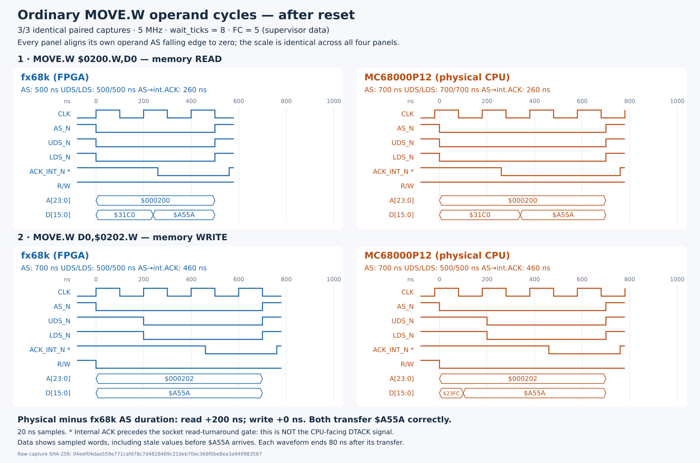

# Ordinary memory MOVE timing

**Build 5 follow-up:** immediate buffer direction and direct ACK eliminate the
read-duration difference. See the [new measurements and waveform](m68000-immediate-direction.md).
The build 4 results below are retained as historical evidence.

Follow-up: [eight consecutive reads and their execution-time cost](m68000-read-sequence.md).



## Physical result

Three planned paired runs completed successfully. Each compared all 18
functional bus transfers, and each CPU changed destination `$0202` from
`$5AA5` to `$A55A` while leaving source `$0200=$A55A`. The captured operand
signal edges and sampled data transitions repeated identically in all three
runs. This is not a reset-vector-only timing difference: the ordinary data
read still takes one additional 5 MHz clock in this harness.

All intervals below are relative to that operand's AS falling edge:

| Measurement | fx68k read | MC68000 read | fx68k write | MC68000 write |
| --- | --- | --- | --- | --- |
| AS asserted duration | 500 ns | 700 ns | 700 ns | 700 ns |
| UDS/LDS assertion | 0 ns | 0 ns | 200 ns | 200 ns |
| UDS/LDS asserted duration | 500 ns | 700 ns | 500 ns | 500 ns |
| Internal ACK assertion, before socket gate | 260 ns | 260 ns | 460 ns | 460 ns |
| `$A55A` first sampled on data path | 240 ns | 340 ns | Already present at AS | 100 ns |

The write's **control-pulse durations match**, not all its timing: physical
write data reaches the FPGA input path 100 ns after AS, while model data is
already present at AS. Both precede the data strobes by at least 100 ns.
The physical CPU's AS edge is also sampled 20 ns after the generated clock
rising edge; the model's AS edge coincides with that sampled clock edge.

The unaligned global run ticks are read `437..462` versus `518..553`, and write
`557..592` versus `668..703` (model versus socket). The delay from operand read
start to operand write start is 2.4 versus 3.0 microseconds; this includes
intervening instruction-word fetches and is not the write pulse's duration.

### Important ACK probe limitation

Scope bit 44 taps the lane responder's internal `dtack_n`. For the socket,
`nuboard_m68000.v` subsequently applies this additional gate:

```verilog
socket_ack_n = dtack_n || (l0[3] && !(data_enabled && data_direction));
```

The read's actual CPU-facing ACK therefore waits for the data-direction
turnaround, whereas writes bypass that gate. The on-board model has no
equivalent external-buffer stage. The diagram labels the captured signal
`ACK_INT_N`, not physical DTACK, and shows actual sampled data transitions
rather than assuming data is valid at internal ACK assertion.

This is a concrete harness asymmetry to investigate before attributing the
read's extra cycle to fx68k. The post-gate socket ACK and CPU-pin arrival times
were not captured, so this experiment does **not** isolate a CPU-core timing
defect or prove the post-gate timing. The earlier reset diagram's responder
DTACK tap has this same pre-gate limitation.

### Evidence

Raw capture: `build/validation/m68000/timing-memory-board-2026-09-18.json`.
SHA-256: `04eef04daa559e771cafd78c7d4828469c21deb70ec368f0be8ea3a940983567`.
VCD: `build/validation/m68000/timing-memory-board-2026-09-18.vcd`.
The raw report retains all three captures, full functional traces, memory
checks, program bytes, build provenance, and shutdown state. VCCB and both
FPGA rails were confirmed off afterward.

Build 4 SHA-256:
`5e873de44af720f0c3dd790bf394f6124403eb93ba53b334c903c0abe67bbe1c`.
All twelve timing relationships and 153 package assignments passed. At 50 MHz,
setup slack is +0.388 ns and hold slack is +0.086 ns. All 11 harness/capture
tests pass. All 60 prior Musashi simulator outcomes, signatures, and captured
bus timings remain unchanged: 56 pass, with the existing ABCD/SBCD/DIVS/DIVU
failures. No MCU firmware, fx68k source, responder, or pin-driver behaviour
was changed for this measurement. Build 3's image and receipt are archived in
`build/fpga/m68000/qualified-build3/`.

## Test program and capture

This test separates normal instruction operand accesses from reset-vector
reads. The executable is assembled for the 68000 ISA from
[`memory_moves.s`](../validation/m68000/memory_moves.s):

```asm
        MOVE.W  $0200.W,D0
        MOVE.W  D0,$0202.W
        MOVE.L  #1,$00100004     ; harness completion marker
stop:   BRA.S   stop
```

Initial memory is `$0200=$A55A`, `$0202=$5AA5`. After execution, both words must
be `$A55A` on both independent CPU lanes. The captured operands must be exactly
one word read at `$0200` and one word write at `$0202`, both with FC=5 (supervisor
data). Instruction prefetches and reset-vector reads use FC=6 and are excluded
from the operand comparison. Full-run functional bus comparison still includes
those transfers, so excluding them from the figure cannot hide a functional
difference.

Core build 4 / scope ABI 2 adds a programmable start tick to the passive scope.
The offset is 256 system clocks (5.12 microseconds); the next 512 samples cover
the two operand cycles on both lanes. The bus responders, pin drivers, CPU
cores, clock divider (5 MHz), and responder wait setting (8 ticks) are unchanged.
AS and UDS/LDS are decoded separately: a write can assert AS before its data
strobes. Both programs must finish successfully, destination RAM must change,
and complete functional bus traces must match before timing is illustrated.

## Reproduce

With the fitted MC68000P12 and exclusive 5 V selection:

```sh
bash fpga/m68000/build_sim.sh
PYTHONPATH=host/src:. python3 -m unittest validation.m68000.test_timing
bash fpga/m68000/build.sh
nuboard configure build/fpga/m68000/outflow/m68000.hex.bin
PYTHONPATH=host/src:. python3 -m validation.m68000.timing \
  --backend board --socket-fitted --program memory --repeats 3 \
  --output build/validation/m68000/timing-memory-board.json
PYTHONPATH=host/src:. python3 -m validation.m68000.draw_memory_timing \
  build/validation/m68000/timing-memory-board.json docs/images/m68000-memory-timing.svg \
  --vcd build/validation/m68000/timing-memory-board.vcd
```

The program words embedded in `timing.py` were checked against the assembled
`memory_moves.s` binary. As with the reset experiment, the capture is sampled
at the FPGA boundary every 20 ns. ACK is the internal responder output before
the socket read-turnaround gate, not an electrical measurement at the CPU pin. No CPU-core defect is established
by a harness-visible timing difference alone.

Scope ABI 2 retains the build 3 sample layout and adds the little-endian 32-bit
start tick at debug addresses `0x32..0x35`. Sample `i` corresponds to run tick
`scope_start_tick + i`, including the existing common observation pipeline.
VCD export preserves that offset; the diagram aligns each operand's AS edge
separately. The recorder remains passive, read-only, and inaccessible while
execution is busy.
