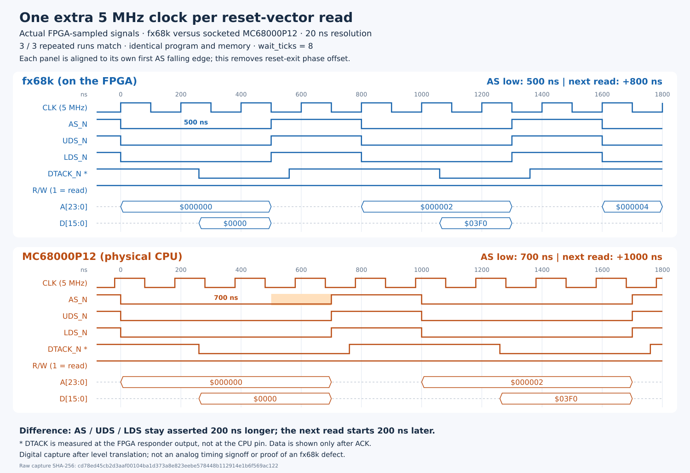

# Minimal paired bus-timing reproduction

These are historical build 3 captures with the socket-only turnaround/ACK
delay. See the [build 5 follow-up](m68000-immediate-direction.md) for the
immediate-direction change and the now-matching sequential-read timing.



## Observed result: three identical physical repetitions

The first read of `$000000` returns `$0000`, followed by `$000002` returning
`$03f0`. Both CPUs complete the tiny program successfully, with all 13
functional bus transactions matching in each of the three runs. The first
two reads' CLK/AS/UDS/LDS/RW/DTACK waveforms repeat identically.

| Measured interval | On-board fx68k | MC68000P12 |
| --- | --- | --- |
| AS/UDS/LDS asserted duration | 500 ns | 700 ns |
| AS assertion to FPGA DTACK assertion | 260 ns | 260 ns |
| Start-to-start interval between reads | 800 ns (4 clocks) | 1,000 ns (5 clocks) |

The first read's absolute sampled ticks are AS assertion `137/148`, DTACK
assertion `150/161`, and AS release `162/183` (model/socket). The second read
starts at `177/198`. Each tick is 20 ns. The diagram removes the initial
220 ns reset-exit offset; the VCD preserves the original common timebase.
The remaining 200 ns difference is therefore not just reset latency.

The sampled DTACK assertion is 40 ns before the next falling generated clock
edge for fx68k, versus 20 ns for the socket lane. This observation motivates
checking acknowledge setup and sampling phase; it does not establish which
component causes the extra cycle. DTACK and CLK arrival at the CPU pins were
not measured.

Subsequent [ordinary memory-move captures](m68000-memory-timing.md) identified
an additional limitation: this scope tap is **before** the socket read-turnaround
ACK gate. The generated CPU-facing ACK can assert later than the responder's
internal ACK shown here. This harness asymmetry must be accounted for before
attributing the extra read cycle to the CPU core.

Raw report: `build/validation/m68000/timing-board-2026-09-18.json`.
SHA-256: `cd78ed45cb2d3aaf00104ba1d373a8e823eebe578448b112914e1b6f569ac122`.
VCD: `build/validation/m68000/timing-board-2026-09-18.vcd`.
The report includes all samples, repeated-run traces, image contents, and
build/source hashes. All three runs finished without transport or cleanup
errors. The final reported VCCB, 3.3 V, and 1.2 V states are off.

Core build 3 image SHA-256:
`c5a64d1e566f255d6c48a7429297b90e7fad8234c29f8210f35673a8a10618be`.
The build passed all twelve constrained setup/hold relationships and all 153
package assignments: 50 MHz setup +1.820 ns, hold +0.086 ns. Core build 2's
image/receipt remain archived under `build/fpga/m68000/qualified-build2/`.

## Minimal executable

The first two reset-vector reads are enough to expose the timing difference;
no instruction-specific behaviour is required. The memory image consists of:

```text
000000: 0000 03f0 0001 0000    ; initial SSP=$000003f0, PC=$00010000
010000: 4e71                   ; NOP
010002: 23fc 0000 0001 0010 0004 ; MOVE.L #1,$00100004 (harness pass)
01000c: 60fe                   ; BRA.S to itself
```

The test runs fx68k and the fitted MC68000P12 at 5 MHz with identical independent
memory images and `wait_ticks=8`. Both programs must pass and their complete
functional transaction traces must match. Three planned repetitions test the
repeatability of the waveform; errors stop the capture and power down the
board. These are not retries after a failed hardware capture.

## Reproduce

With the MC68000P12 fitted, exclusive 5 V selected, and VCCB initially off:

```sh
bash fpga/m68000/build_sim.sh
PYTHONPATH=host/src:. python3 -m unittest validation.m68000.test_timing
bash fpga/m68000/build.sh
nuboard configure build/fpga/m68000/outflow/m68000.hex.bin
PYTHONPATH=host/src:. python3 -m validation.m68000.timing \
  --backend board --socket-fitted --repeats 3 \
  --output build/validation/m68000/timing-board.json
PYTHONPATH=host/src:. python3 -m validation.m68000.draw_timing \
  build/validation/m68000/timing-board.json docs/images/m68000-reset-timing.svg \
  --vcd build/validation/m68000/timing-board.vcd
```

The capture command checks the core identity, scope ABI, configured image
digest against the checked build receipt, and 5 V selector before enabling
VCCB. It shuts down and reads back all rail states in its cleanup path.
Completion uses the normal mailbox interrupt, not host status polling.

## What is measured

Core build 3 adds a passive 512 x 128-bit sampler. It records once per 50 MHz
clock, i.e. every 20 ns, and freezes after 512 samples. Both lanes, including
the CPU clock, pass through an identical two-register observation pipeline.
The run's sample zero is at the beginning of execution, with that common
pipeline delay. The diagram aligns each lane's first AS falling edge to zero
to distinguish read duration from reset-exit latency. Clock phase relative to
AS is preserved within each panel.

The socket signals are observed at the FPGA side of the board's level
translators. DTACK is the FPGA responder's generated output; it is **not** a
return measurement at the CPU pin. The physical CPU's data bus is sampled via
the bidirectional FPGA input path; the model uses its selected input/output
data. Address is drawn during AS; data is drawn only after DTACK assertion.
Idle bus values are deliberately not interpreted as transfers.

This is digital capture with 20 ns quantization, not an oscilloscope or
electrical timing signoff. It establishes harness-visible bus timing, not by
itself a defect in fx68k. Translator delay, DTACK setup relative to the CPU's
clock, and core sampling phase remain possible contributors.

## Scope ABI 1

Register `0x2e` gives sample count; `0x30` gives scope ABI version 1. Read-only
memory `0x50000..0x51fff` contains 512 little-endian `<QQ>` samples: model,
then socket. The same layout applies to each 64-bit lane word:

| Bits | Observed value |
| --- | --- |
| 23:0 | Byte address |
| 39:24 | Data |
| 40 / 41 / 42 | AS_N / UDS_N / LDS_N |
| 43 / 44 / 45 | R/W / internal DTACK_N before socket gating / BERR_N |
| 48:46 | Function code |
| 49 | Common generated CPU clock |
| 50 / 51 | RESET_N / HALT_N; model uses its oRESETn/oHALTEDn outputs |
| 63:52 | Reserved zero |

Capture memory is inaccessible while a run is busy and is never host writable.
The module has no path that drives a CPU bus or changes responder behaviour.
Its simulations preserve all 60 prior Musashi results and captured transaction
timings (56 passes and the same four existing failures). The original eight
harness regressions plus two new capture/decoder tests pass.
